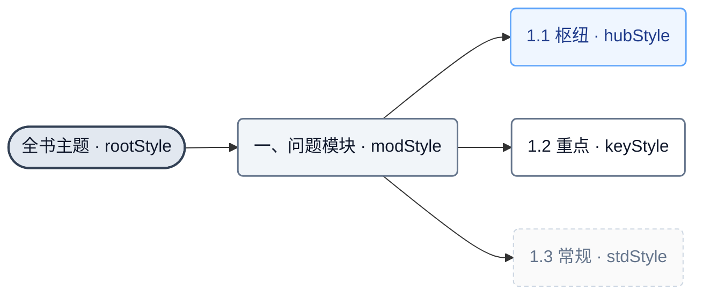
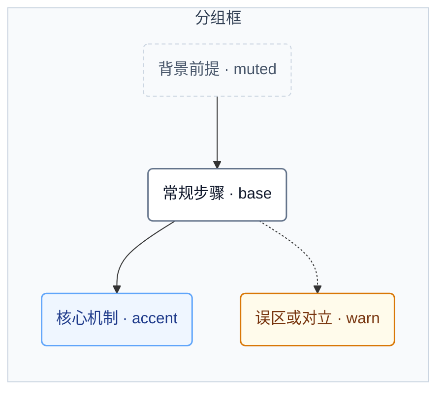

# 默认语言风格、版式与绘图规范

本文件规定无额外说明时的默认表达、排版与 Mermaid 绘图规范（用户另有偏好时，以 `notes/plan.md`「写作偏好」为准）。

## 受众与基调

面向零专业背景的门外汉，用温和、平实的普通书面语把道理讲透。

## 五层写法

| 层次 | 具体做法 |
| --- | --- |
| **段落推进** | 顺着上一层留下的疑问自然引出下一层，用简短的问题带着读者往前走。 |
| **概念命名** | 先在具体现象里让读者看见规律，再给出专业术语；核心概念首次正式定义附英文原词，全书固定沿用同一译名。 |
| **例子用法** | 一个理论段落只回答一个问题：先用刚学的概念把当前场景推进一步，顺着原例子改一个条件试出边界，再另起段落换新场景引入下一个概念。 |
| **人称分工** | 写亲身体验用“你”带入场景，谈共同习惯用“我们”，交代理论主张与前提写明“作者”或学者姓名。 |
| **词语与节奏** | 用普通准确的日常动词说明发生了什么，用专业名词保证精度，保持生活化直觉；句式顺着推理自然舒展，长短错落。 |

## 语感示范

> 假设两家餐厅的平均等位时间都是十分钟。第一家几乎每个人都正好等十分钟，第二家则是有人只等了两分钟，有人却等了十八分钟。平均值把一整组数字压缩成一个数，方便快速比较；可要是你更关心自己会不会等上超过一刻钟，单看平均值就不够了，还得回头看看等位时间的分散程度。

## 表达形式选用

散文为主体；需要更直观地呈现内容时，按各自优势选用以下形式：

- **列表**：有先后顺序用编号步骤，并列要点或两方对照用 `-` 列表。
- **表格**：适合多类型、多流派或同组对象按多维度横向对比；表上已清楚的内容，正文直接往下讲。
- **流程图 / 机制图**：把机制运作、因果链条或分支转折可视化摊开，解决纯文字绕不清的地方（配色见下文）。
- **引用块 `>`**：用于核心定义、原典原话、凝练金句与节末自测块。
- **公式或代码**：理科或技术内容需要精确交代变量关系或操作逻辑时使用，紧跟直觉说明。

## 排版与标点约定

- **加粗**：仅用于两处——行首结构标签、核心概念首次正式定义。
- **术语首现**：首次正式定义统一写 `**中文译名（english term）**`（全角括号，英文除专有名词外全小写），后续正文不再重复括注英文。
- **跨节引用**：提到整块统一写 `模块一`、`模块二`（不用阿拉伯数字 `模块 1`）；提到具体小节统一写 `1.1 节`、`2.3 节`。
- **引号、标点与空格**：正文中文引号统一用 `“”`（不用 `「」`），书名与篇名用 `《》`；括号只放英文原词或三五字短注，补充解释直接写成顺畅分句；停顿统一用逗号、句号、冒号和括号（不用破折号 `——`）；中文与英文、数字之间保留 1 个半角空格，中文标点前后不加空格。

## Mermaid 绘图与固定色板

- **通用规则**：一图一任务；节点标签用 4–12 字精简短名，含括号或特殊符号时加双引号；避免跨跳连线交叉；4 步以内线性推演固定 `flowchart LR`，超过 4 步或含多层分支固定 `flowchart TD`。

### 全书思维导图（`map` 与 `guide` 共用）

- 固定使用 `flowchart LR` 三层纯树（全书核心 → 各模块 → 枢纽 / 重点 / 常规）；根节点用胶囊 `(["主题"])`，二三级节点统一用圆角矩形 `("...")`。
- 导图正上方固定写明图例：`（浅蓝 = 枢纽 ｜ 实框 = 重点 ｜ 虚框 = 常规；点击节点跳转对应正文）`。
- 有目标标题的节点加 `click 节点ID "#标题锚点"`；锚点固定由对应正文标题去掉标点（`、` `.` `：` 等）、空格转 `-` 生成（如 `## 一、隐喻如何影响思想与行动` → `#一隐喻如何影响思想与行动`，`### 1.1 概念隐喻与凸显隐藏` → `#11-概念隐喻与凸显隐藏`）。
- 节点样式与色板固定按下方示例中的 5 个 `classDef` 直接复用，不另行配色：

### 正文局部结构图（流程、机制与对比图）

- 节点样式与色板固定按下方示例中的 4 个 `classDef` 直接复用，不另行配色（`base` = 常规节点或标准步骤；`accent` = 核心机制、主路径或结论；`muted` = 背景前提或次要条件；`warn` = 仅用于误区、失灵条件或竞争对立面）：

- 含 `subgraph` 分组时按上图格式固定样式：`style <子图ID> fill:#f8fafc,stroke:#cbd5e1,stroke-width:1px,color:#334155`。
